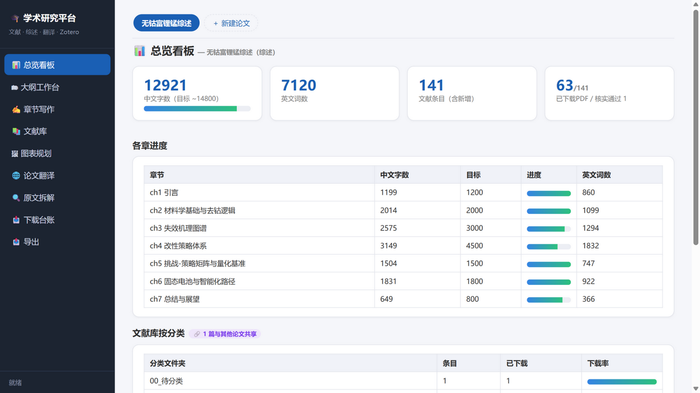
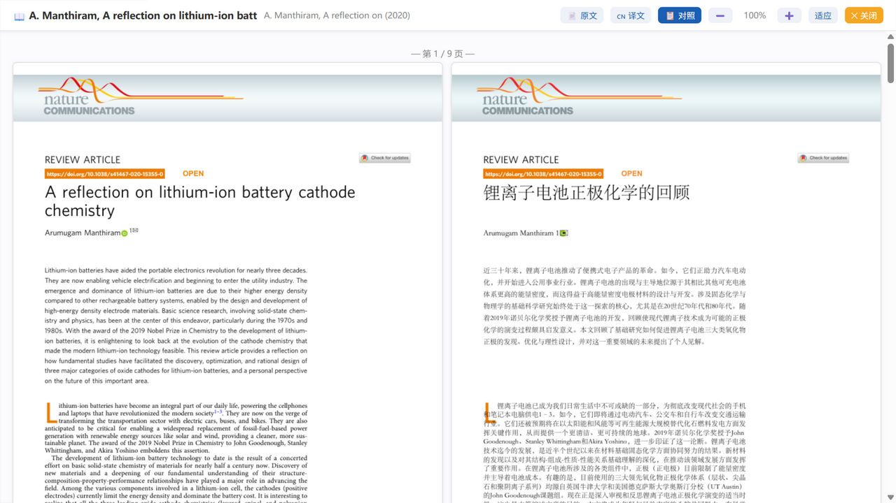

# 🎓 Academic Research Platform · 学术研究平台

一个本地优先（local-first）的多论文写作与研究管理平台：**对标优秀论文 → AI 拆解 → 建项目 → 攒文献 → 逐章写作 → 导出**，全流程在一个浏览器页面完成。纯 Python 标准库后端，零数据库，数据即文件。



## ✨ 功能特性

- **多论文项目**：顶部论文标签栏，每篇论文拥有独立的大纲 / 章节 / 文献库 / 图表规划 / 拆解报告 / 导出，一键切换
- **对标论文 AI 拆解**（DeepSeek）：新建论文时喂入一篇优秀论文 PDF，自动生成拆解报告（章节骨架 / 叙事逻辑 / 写作模板 / 图表策略 / 可借鉴句式 / 差异化建议）+ 你的论文大纲草稿 + 章节结构 + 文献分类文件夹建议
- **文献库**
  - 批量导入（扫描文件夹自动提取题录 + Crossref 补全 / RIS / BibTeX），关键词自动建议分类
  - **一键翻译列**：🌐 翻译 → 原地展开全屏阅读器（不跳转），默认中英对照边等边读，翻完自动出中文并落盘为 `原名_中文版.pdf`，下次「📖 读中文」秒开
  - 阅读器支持 📄 原文 / 🇨🇳 译文 / 📋 对照三模式，50%–400% 缩放（自动高清渲染），整卷连续滚动
  - 跨论文**共享标签** 🔗：同一文献被多篇论文引用时双向标记，可一键过滤；PDF 磁盘上只存一份
- **Zotero 双向集成**：一键录入（含查重）、PDF 附件自动挂载、条目「打开」按钮直达 Zotero 阅读器中的 PDF（`zotero://open-pdf`）
- **图表规划**：每张图给出类型/横纵轴/单位/范围/图例的确切定义，自动生成图示样例草图（示意图、折线、柱状、散点、热图、时间轴、表格矩阵 7 类），画图前先对齐思路
- **写作**：Markdown 编辑 + 1.5s 防抖自动保存 + 本章文献侧栏 + 对标拆解参考 + 实时预览；中英双语成稿
- **导出**：整篇一键导出 MD / HTML / Word（docx），文件名按项目命名，输出到项目自己的导出目录
- **内置论文翻译服务**（可选）：版式保真英文 PDF → 中文（DeepSeek，自动跳过参考文献、术语表、宋体/黑体重排）



## 🚀 快速开始

### 依赖

- Python 3.10+（平台本体零第三方依赖；推荐 `pip install -r requirements.txt` 启用 PDF 阅读/Word 导出/翻译等增强功能）

### 启动

```bash
git clone https://github.com/Mou-xiaobai/academic-platform.git
cd academic-platform
pip install -r requirements.txt   # 可选但推荐
# Windows：双击 start-platform.bat（或 start-silent.vbs 无窗口启动）
python platform/server.py          # 通用方式
```

浏览器自动打开 <http://127.0.0.1:8320>。仓库自带一个示例论文项目（含 AI 拆解的演示数据），点「＋ 新建论文」即可开始你自己的论文。

### 桌面快捷方式（Windows）

双击 `create-desktop-shortcut.bat`，桌面生成带图标的「Academic Platform」快捷方式，双击即用。

## ⚙️ 配置（可选）

复制 `config.example.json` 为 `platform/config.json`：

```json
{
  "lit_root": "D:\\MyPapers",
  "zotero_exe": "C:\\Program Files\\Zotero\\zotero.exe"
}
```

| 键 | 作用 | 默认 |
|---|---|---|
| `lit_root` | PDF 文献库根目录（按论文项目建子目录） | `~/Documents/MyPapers` |
| `zotero_exe` | Zotero 可执行文件路径（启动/挂载用） | `D:\zotero\zotero.exe` |

**AI 功能（拆解/翻译）**需要 DeepSeek API key，从环境变量 `DEEPSEEK_API_KEY` 或 `~/.dsh/.credentials.yaml`（`DEEPSEEK_API_KEY: sk-...`）自动读取；翻译服务也可在 `translator/data/settings.json` 中配置。没有 key 时平台其余功能不受影响。

## 📁 目录结构

```
academic-platform/
├── platform/            # 平台后端（Python 标准库 HTTP 服务，端口 8320）
│   ├── server.py        # 全部 API + 静态托管
│   └── app/             # 前端（原生 JS SPA）
├── translator/          # 论文翻译服务（FastAPI，端口 8321，按需自动拉起）
├── 01_拆解报告/          # 示例项目的 AI 拆解报告
├── 03_大纲/ 04_文献库/ 05_成稿/ 06_导出/   # 示例项目数据（数据即文件）
├── 论文项目/             # 新建论文项目的数据目录（运行时生成）
├── start-platform.bat / start-silent.vbs / create-desktop-shortcut.bat
└── icon.ico  config.example.json  LICENSE
```

## 🔒 隐私

一切数据都留在本机：文献题录/正文/笔记均为本地 JSON/Markdown 文件；仅 AI 拆解与论文翻译会把你提交的论文文本发送至 DeepSeek API；Zotero 集成仅访问本机 Zotero（127.0.0.1:23119 / 本地 sqlite）。无任何统计上报。

## 🛠️ 常见问题

- **端口被占用**：修改 `platform/server.py` 末尾 `port = 8320`
- **翻译服务未启动**：`pip install -r translator/requirements.txt`；平台会在首次使用时自动拉起（约 10–25 秒）
- **打不开 PDF**：确认 `pip install PyMuPDF`
- **Zotero 挂载失败**：挂载需完全退出 Zotero 后进行（平台会自动关闭并重启它，操作前自动备份数据库）

## 📄 License

[MIT](LICENSE) © 2026 Mou-xiaobai
